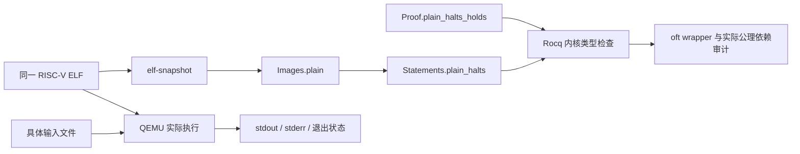

# Gray Wolf 原生复现 OSS Verify：zlib/checksum_fuzzer

> 已于2026年11月24日在 Gray Wolf 完成原生复现：定向 Dune 构建、官方 Specification/Proof 检查均成功，同一 ELF 的三个合法输入均实际退出0。全程未使用容器，未修改原始规格或证明。以下结论均对应实际保存的日志。


本 GitHub 仓库保存完整上游源码快照和 `local-reproduce/` 复现资料。上游源码树保持为 `a36ade652af3a438ecfa227a79240b7480b00ed4`；上游提交信息保存在 `upstream-commit.json`。为满足 GitHub 单次上传限制，源码按批次导入，提交历史不是上游完整历史。

这里的成功日志是2026年11月24日 Gray Wolf 上的实际运行记录，保存于 [`evidence/2026-11-24/`](evidence/2026-11-24/)。发布版新增完整上游 Git tree 校验，允许 `local-reproduce/` 自身新增提交；原 Specification、Proof、官方检查逻辑和二进制哈希不变。

这些脚本可复用 Gray Wolf 上已安装的独立原生环境。它们不是空机器的一键安装器；环境脚本及前置条件见 [`native-support/README_CN.md`](native-support/README_CN.md)。

## 复现范围与结果记录

本次以 `zlib/checksum_fuzzer` 的 `plain_halts` 为完整验证任务，研究同一份 RISC-V ELF 的 Program、Specification、Proof 及实际执行。该目标还有 sanitizer agreement、classifier 等其他定理；本次不把它们都算作已经验证。仓库其他项目不参与形式化构建。

| 项目 | 当前记录 |
|---|---|
| SSH 配置名 | `graywolf.top`（用户称 Gray Wolf） |
| 远程仓库绝对路径 | `/home/wupeihan/projects/oss-verify-proofs` |
| 上游提交 | `ad0a85d4c37bc1c985ef72826a02ee33b01cbbd6` |
| 上游 Git tree | `a36ade652af3a438ecfa227a79240b7480b00ed4` |
| release | `2026.11.3` |
| 服务器资源与环境 | Ubuntu 22.04.5、x86_64、2 × AMD EPYC 7T83、256逻辑CPU、503 GiB内存；检查时可用约244 GiB；见独立环境 `logs/host-native.txt` |
| 既有开发环境与磁盘 | 宿主内核5.15.0-203、GCC11.4.0、系统Python3.10.12、系统QEMU6.2.0；检查时`/home`可用3.0TiB，构建改用本机NVMe普通目录 |
| 原生工具链安装 | 成功；`INSTALL_EXIT=0`、`NATIVE_SELFTEST_PASS`、`SELFTEST_EXIT=0`；错误的 `False := I` 证明被拒绝，退出1 |
| 下载及完整性校验 | 官方 fetch：136个二进制，0 problems；所选 plain 的SHA-256与元数据一致 |
| 官方 facts-to | 全树事实及规则检查成功，`FACTS_TO_EXIT_STATUS=0`；此阶段不构建证明 |
| NVMe 构建视图 | 53条官方路径；源closure 8769项一致、复制字节8768项一致；14个ELF校验0错误；27个proof目录、8099个library `.v` |
| 定向 Dune 构建 | 成功，`BUILD_SCRIPT_EXIT=0`；13:18:21开始、13:34:22结束；日志 `logs/20261124T131821-build-2212848.log` |
| 官方 Specification 检查 | 成功：40个登记声明均已定义；`1 step(s) passed, 0 failed`；工作目录 `oft-check-uwfhehc5` |
| 官方 plain_halts Proof 检查 | 成功：`proves zlib/checksum_fuzzer/plain_halts; assumptions: 16 axioms, all allowed`；`1 step(s) passed, 0 failed`；工作目录 `oft-check-2slgdwhg` |
| 三个合法输入实际运行 | 全部成功：ascii、bytes各输出一行0；repeat4输出四行0；均退出0、stderr为空；另测短头输入退出2 |
| 验收脚本退出状态 | `BUILD_SCRIPT_EXIT=0`、`VERIFY_SCRIPT_EXIT=0`、`RUN_SCRIPT_EXIT=0`；fetch.sh重复执行也退出0 |

整个流程在宿主 Linux 中原生运行。`toolchain/checker.Dockerfile` 和 `toolchain/runner.Dockerfile` 只用于核对依赖，不运行 Docker、Podman 或其他容器。

## 下次如何启动

通过 VSCode Remote SSH 连接 `graywolf.top`，打开上表的远程仓库目录，在 **Bash** 终端中运行：

```bash
source local-reproduce/env.sh
command -v rocq dune oft elf-snapshot qemu-riscv64
rocq --version
dune --version
qemu-riscv64 --version

bash local-reproduce/fetch.sh
bash local-reproduce/build.sh
bash local-reproduce/verify.sh
bash local-reproduce/run.sh
```

每个脚本先切换到仓库根目录，因此执行后不依赖调用者原先的工作目录。`env.sh` 设置 `OSS_VERIFY_ROOT`、本项目 Python 虚拟环境及独立工具链的 PATH，并默认限制 `OFT_JOBS=8`。需要调整并行度时，在启动脚本前设置，例如 `export OFT_JOBS=4`。不要同时运行多个 build 或 verify，它们共享 NVMe 视图的 `_build/`。本次定向build使用8并行；官方verify使用 `OFT_JOBS=32 nice -n 10 bash local-reproduce/verify.sh`，显式覆盖默认值。并行度改变调度，不改变证明命题或审计规则。

`env.sh` 将栈软限制设为不超过硬限制的 2 GiB；这是大型 Rocq 证明的运行需求，不会改变内核检查规则。`DUNE_CACHE=disabled` 关闭共享缓存；`TMPDIR` 指向 `/var/tmp/wupeihan-oss-verify-reproduce/ad0a85d4/check-work`。verify 退出时，无论成功或失败，脚本都会把检查工作目录复制回主仓库 `local-reproduce/logs/tmp/`。

build、verify、run 均先调用仓库内 `native-support/prepare-view.sh "$OSS_VERIFY_ROOT"`，准备或复核下面的原生视图。verify 在官方检查前后调用 `check-source.py`：从当前提交顶层只排除 `local-reproduce` 后，必须得到原始上游 Git tree；它还在官方检查结束后复核工作树源码。只有两阶段检查及所有复核全部成功，才记录当前实际提交并生成 run 所需的验证标记。历史成功证据不是运行许可，新的clone仍须自行执行verify。

`run.sh` 设计为在 verify 成功后执行，并核对被验证二进制的 SHA-256。不能手工伪造 `verified-commit.txt` 或 `verified-program.sha256` 来绕过此前的验证。

## 版本如何确定

版本依据当前提交中的 `release.yaml`、`dune-project`、`toolchain/checker.Dockerfile`、`docs/checking.md`、`docs/running.md` 和 `tools/oft/requirements.txt`，不是取各工具的最新版。

| 组件 | 上游要求 | 本机安装结果 |
|---|---|---|
| OCaml | checker 基础环境为 4.14 系列 | 4.14.2 |
| opam | Dockerfile 未单独指定版本 | 2.6.1 |
| rocq-runtime / rocq-core / rocq-stdlib | 9.2.0 | 三个包均为9.2.0 |
| Dune | 3.23.0；`(using rocq 0.13)` | 3.23.0 |
| rocq-stdpp / rocq-stdpp-bitvector | 1.13.0 | 两个包均为1.13.0 |
| coq-flocq | 4.2.2 | 4.2.2 |
| rocq-read-file | 0.0.2 | 0.0.2 |
| rocq-linux-process-semantics-core | commit `c0dd863a0f8f307beca7f2ee5cb4d7686a875779` | 已安装；opam显示`dev`，实际由锁定源码树标识 |
| LPS 裁剪源码树校验值 | `3c00fedfece3a07062c75c74f116ead141858da6779015d2b5633c3fc10a247f` | 实算一致，见`logs/lps-core-tree.sha256` |
| Rocq opam 元数据 | commit `d330865276542eb86269e88d4f3d9d4c974fee2e` | 按此pin准备 |
| QEMU user / qemu-riscv64 | 10.0.11 | 10.0.11，官方 Debian 静态包哈希验证通过 |
| Python | Python 3 | 3.10.12，独立 venv |
| Python 包 | idna 3.20，PyYAML 6.0.3 | `pip --require-hashes` 安装成功 |

发布版从 `local-reproduce/native-support/env.sh` 读取环境配置，实际依赖仍位于 `$HOME/projects/oss-verify-native-env`。LPS 仅作为本项目依赖安装在独立依赖目录，没有作为另一个研究项目展开。实际路径：opam root 为 `/home/wupeihan/projects/oss-verify-native-env/opam-root`，switch 为 `oss-verify-4.14`；LPS 核心在环境的 `deps/lps-core`；QEMU 在 `qemu/usr/bin`；Python venv 在 `python-venv`，原工作目录的 `local-reproduce/.venv` 链接至它；发布版直接将这个独立 venv 的bin加入PATH，无需提交或复制虚拟环境。

已安装包清单保存在独立环境的 `logs/opam-installed.txt`，工具链自检在 `logs/native-selftest.log`。主仓库 `local-reproduce/logs/environment-final.log` 记录了在真实远程 Shell 中 source 环境后所有必要命令的路径与版本，结果 `ENVIRONMENT_CHECK_EXIT=0`；14:07 检查时本机 NVMe 可用926GiB。`host-native.txt` 记录的是安装前已有的系统 QEMU 6.2.0；复现脚本通过 PATH 使用独立安装的10.0.11。

## 为什么在 NVMe 视图中构建

主仓库持久保存在 `/home/wupeihan/projects/oss-verify-proofs`，适合 VSCode 阅读和保存实验记录。服务器 `/home` 使用 ZFS 共享存储；此次读取大量证明小文件时出现显著 metadata/I/O 等待。因此，构建使用本机 NVMe 上的普通目录 `/var/tmp/wupeihan-oss-verify-reproduce/ad0a85d4`。这是宿主文件系统上的目录，不是容器。

该目录的角色如下：

| 路径（相对上述 NVMe 根） | 用途 |
|---|---|
| `full/` | 同一官方归档的完整只读解包树，仅用于全树facts与规则检查；不在这里全量构建 |
| `facts/zlib/checksum_fuzzer.yaml` | 官方`--facts-to`生成的本目标事实快照，权限444 |
| `view/` | 官方`unitpaths`确定的本目标源码、全部proof目录与library、14个ELF、原始工具副本 |
| `view/_build/` | 实际 Dune/Rocq 编译产物 |
| `check-work/` | 官方`oft-check-*`工作目录；verify退出时复制回主仓库logs/tmp |
| `source-manifest.json` | 从完整原始snapshot记录的源文件集合与SHA-256，用于逐项核对主仓库 |
| `view-manifest.json` | view源码文件集合与SHA-256 |
| `prepared.json` | 将commit、归档SHA、两个manifest及facts摘要绑定到本次准备 |
| `identity-evidence/` | 官方归档Git tree、签名commit对象ID与归档SHA核验记录 |
| `preparation-logs/` | 原生准备及重复校验日志 |

准备过程遵循仓库 `tools/oft/ci/check-units.sh` 中的 facts/view 划分，但以普通文件复制和原生工具执行：先对完整、同一版本源码运行官方 `oft check --facts-to`，再运行官方 `python3 -m oft.unitpaths --part build --dune-project-to …`。仅将其中的容器挂载和容器执行替换为原生目录与命令，没有改写检查器、规格或证明。

`unitpaths`生成了53条路径。它保留全部27个proof目录以及8099个library `.v`，并不是删掉未选中的证明目录。只有全局`dune-project`采用官方生成的缩减版，保留公共构建形式以及core、meta、zlib、zlib-proofs四个包；相应目标的局部`dune`文件完全不变。

首次准备日志记录 `FACTS_TO_EXIT_STATUS=0`、主仓库源closure 8769项一致、view复制字节8768项一致以及官方`verify_builds (14, 0)`。后两个数量相差一，是因为`dune-project`单独核对为官方缩减形式。facts和view源文件设为只读，view顶层保留创建`_build/`所需写权限。主仓库核心源只被读取和核对，不为加速或通过验证而修改。

facts本身只记录部分元数据文件的hash，不能单独证明所有源码相同。因此准备脚本额外保留并比较完整选中源closure和view的manifest；重复执行会重新核对路径集合、SHA-256及facts摘要，变化时拒绝继续。哈希复核使用8个线程以降低共享存储延迟。view与facts来自同一个已核验源码snapshot，完整事实规则检查没有被省略。

若整个 NVMe 临时目录被系统清理，`prepare-view.sh`会从持久归档 `/home/wupeihan/projects/oss-verify-native-env/downloads/oss-verify-proofs-ad0a85d.tar.gz` 重新解包、运行官方facts检查和准备view。其SHA-256为 `48c946dd504ab88a8e26e84d6103832bdd67d0d85f1cc9edfb61cc863a39631a`。准备成功不等于形式化构建或证明已经成功，后续仍需执行build与verify。若仅部分缓存或标记损坏，脚本会拒绝继续，避免混用状态；应保存失败日志后重新准备完整缓存。

## Program：真实软件与二进制身份

Fuzz Target 源码来自 `google/oss-fuzz` 的提交 `fadbcdfb9e96aaa26734fbc936ab64a6f4f18ab4`，原路径 `projects/zlib/checksum_fuzzer.c`。仓库副本位于 `projects/zlib/checksum_fuzzer/source/checksum_fuzzer.c`，`harness.yaml` 标明该目标源码未修改。

它链接的库是 zlib 1.4，`madler/zlib` 提交 `99623ef7097352da7993ba614161fd6a311e046e`。本发布构建包括公开的 inflate 修复；具体构建差异记录在 target README、`harness.yaml`、`projects/zlib/project.yaml` 中。被验证的程序是已经编译和静态链接的 RV64G Linux ELF，包括 driver、fuzz target、zlib 和运行库。

| 二进制字段 | 当前提交记录 |
|---|---|
| 文件 | `projects/zlib/bin/checksum_fuzzer/checksum_fuzzer.plain` |
| 大小 | 52952 字节 |
| SHA-256 | `abc3576b38eb0fc9760857226677d99b5d66abee1b84c42deb4781f400479c89` |
| 发布归档 | `zlib-bin.tar.zst`，release `v2026.11.3` |
| 归档大小 | 1912423 字节 |
| 归档 SHA-256 | `07ea992e0d07e50314b8f4feefb6c594efa43fc927ad25e5411013a54a34211e` |

官方 `oft fetch` 的最小粒度是项目，因此 `fetch.sh` 调用 `oft fetch zlib`，随后 `oft verify-sha zlib`。这会下载该 zlib 项目的发布归档，约 1.9 MB，而不是下载全仓项目。当前 target 的 `Images.v` 引用 14 个 ELF 映像，包含四种 build、四种 original 和六种 classifier；即使只证明 `plain_halts`，构建这个原始映像模块仍需这些文件。没有通过改写 `Images.v` 删除依赖。

2026年11月24日首次部署时，直接GitHub Git传输失败后，从官方源码归档恢复了精确的仓库对象：使用流式`git fast-import`导入317767个文件、12954173309内容字节，得到Git tree `a36ade652af3a438ecfa227a79240b7480b00ed4`；再按GitHub提供的原始签名提交内容重建commit object，ID精确匹配 `ad0a85d4c37bc1c985ef72826a02ee33b01cbbd6`，该过程退出0。随后通过标准`git clone --no-checkout --no-hardlinks`从这个已验证bare镜像恢复主仓库Git元数据，保留原始解包源码，主仓库HEAD/tree均已匹配。

上述首次部署路径保留了原工作目录的上游提交身份；本GitHub发布副本采用开头说明的分批导入历史，源码tree仍完全相同。真实证据在独立环境 `logs/fast-import-upstream.log`、`logs/upstream-archive.sha256` 和 NVMe `identity-evidence/`；网络失败尝试的日志也保留。早期逐文件导入方案没有用于最终上传；实际流式导入辅助脚本快照见 `native-support/fast-import-upstream.py`。

## ELF 怎样变成 Rocq 对象

`projects/zlib/checksum_fuzzer/images/dune` 中每条 rule 调用 LPS 的 `elf-snapshot`。plain build 对应的调用形态是：

```text
elf-snapshot <checksum_fuzzer.plain> Plain.v \
  --prefix Plain --module-name M \
  --namespace OSSVerify.zlib.checksum_fuzzer.images
```

工具从 ELF 中提取载入段、入口地址和 program headers，产生 `Plain.v` 和 `Plain_seg_000.hex` 至 `Plain_seg_003.hex`。它们由 Dune 生成在 `/var/tmp/wupeihan-oss-verify-reproduce/ad0a85d4/view/_build/default/projects/zlib/checksum_fuzzer/images/`，不手工存入源码目录。`rocq-read-file` 支持把段字节作为证明可读取的数据；LPS 定义这些数据的类型与程序执行语义。

`Images.v` 用 `mkImage Plain.M.loaded_segments Plain.M.init_pc Plain.M.phdrs` 构造 `Images.plain`，并通过 `plain_wf` 检查映像良构。Proof 库中的 `World/Src_zlib_checksum_fuzzer_repro.v` 将旧的内部命名映射到这个生成模块。`proofs/plain_halts/Proof.v` 的 `world_plain_is_images` 再通过计算一致性把最终证明连接到同一个 `Images.plain`。

底层 `rocq-linux-process-semantics-core` 提供静态 64 位 RISC-V Linux 进程的形式化模型：指令、相关系统调用、内存映像、合法入口和输入、执行轨迹、错误及终止行为。`theories/Shapes.v` 将本仓库的规格形状连接到这些 LPS 定义；本工程使用其定义和已证明引理，而不重新研究或修改 LPS。

SHA-256 检查确定 ELF 文件身份；映像生成建立其形式化表示；LPS 提供表示的执行含义；Proof 证明该表示满足 Specification。QEMU 则在现实环境中执行同一个 SHA-256 的 ELF。这几步用途不同，不能相互替代。

## Specification 与 Proof 分别是什么

对外验收规格位于 `projects/zlib/checksum_fuzzer/Statements.v`：

```coq
Definition plain_halts : Prop :=
  halts_within_budget Budgets.Standard.lim_source
    Exits.ok_or_refused Images.plain.
```

其含义是：对每个 LPS 合法的 `ProcInput` 和 `ExecEntry`，在环境仅发生由进程状态所迫的失败（`forced_only`，六类额外失败开关均为 false），且从未因超过 16 GiB 预算而被拒绝内存时，每次执行正常退出 0 或 2。在这些前提内，断言失败导致的 abort 不在允许结果中，因此已执行的 CRC-32、Adler-32 断言不会失败。

这里的 16 GiB 是形式化规格的资源前提；`env.sh` 的 2 GiB 栈软限制用于运行证明工具，两者不是同一限制，`run.sh` 也没有把该规格转换成 QEMU 的 16 GiB 配额。

`plain_halts` 约束终止和允许的退出状态，不直接规定 stdout 内容。退出 0 也不表示所有业务分支都已执行：例如 harness 对超过大小限制的 payload 可以直接返回。本次三个合法样例均非空且不超过 1 MiB。

这不是“任意 zlib 源码都正确”的结论，也不自动覆盖另一个编译器生成的二进制、其他架构、其他 zlib 版本或 LPS 尚未建模的操作。LPS 自身的边界见仓库 `docs/semantics.md`。该文档声明此版本模型目标为 Linux v6.18.46 / RV64GC，并明确说明只覆盖 Linux 的一部分，仍有未建模范围和已知 soundness gaps。LPS 也不以 QEMU user mode 为目标：例如其文档记录 shrinking `mremap` 在 QEMU 与 Linux 之间存在行为差异。因此，本次 QEMU 样例成功是独立的实际执行记录，不能把形式化结果扩大为对 QEMU 实现或全部 QEMU 行为的证明。

Proof 的入口是 `proofs/plain_halts/Proof.v`：

```coq
Theorem plain_halts_holds : Statements.plain_halts.
```

它使用 `proofs/lib/plain_halts/Thm_halts_fo_okr.v`、`proofs/lib/plain_halts/Thm_checksum_halts_okr.v`、`proofs/lib/plain_halts/OkrEnds.v` 以及 `plain_halts_any_exit/` 下的证明库。库内部的 `proofs/lib/plain_halts_any_exit/Spec.v` 是辅助行为规格，用于分步证明二进制实现该行为；它与外部最终验收命题 `Statements.plain_halts` 是两个层次。这些文件以及 `proofs/lib/plain_halts_any_exit/World/Src_zlib_checksum_fuzzer_repro.v` 均已在远程实际解包源码中逐个确认存在；这些相对路径以`projects/zlib/checksum_fuzzer/`为起点。

`proofs/plain_halts/proof.yaml` 记录目标定理和规格 fingerprint：`040b3d1a3910b59b152d802323d0147b3e18eeb388cc672f7b296a5b09244118`。`harness.yaml` 里的 `status: open` 不能单独用于判断最终是否有证明，工具还会读取实际 proof 登记；本目标确有该 Proof 文件与登记。本机已通过官方验证，成功记录见下文日志索引。

## Dune 构建与官方检查

`build.sh` 先运行准备脚本并切换到 `$OSS_VERIFY_VIEW`，仅指定以下 `.vo` 目标：

```bash
bash "$OSS_VERIFY_ROOT/local-reproduce/native-support/prepare-view.sh" "$OSS_VERIFY_ROOT"
cd "$OSS_VERIFY_VIEW"
dune build --display short -j "$OFT_JOBS" \
  projects/zlib/checksum_fuzzer/Images.vo \
  projects/zlib/checksum_fuzzer/Statements.vo \
  projects/zlib/checksum_fuzzer/Characterise.vo \
  projects/zlib/checksum_fuzzer/proofs/plain_halts/Proof.vo
```

局部 `dune` 文件的 `rocq.theory` 声明命名空间和依赖；Dune 计算依赖关系、生成 ELF 映像并调用 `rocq compile`，将 `.v` 编译为 `.vo`。本次 `trace.csexp` 中实际记录了 `compile -q … -native-compiler ondemand -boot -R … -Q …` 参数，编译器路径属于本项目独立 opam switch；`-R`/`-Q` 将物理目录绑定到 Rocq 逻辑命名空间。Rocq 内核对产生的证明项做类型检查。tactic、`vm_compute` 等负责构造或计算证明，最终的 theorem 仍需通过内核规则。

`oft` 本身是 Shell 入口：设置 `PYTHONPATH=$ROOT/tools` 和 `PYTHONDONTWRITEBYTECODE=1`，然后调用 `python3 -m oft --root "$ROOT" …`。本环境直接使用已安装依赖的 venv Python；`tools/oft/__main__.py` 中 `cmd_fetch` 调用 `fetch.cli`，`cmd_verify_sha` 调用 `fetch.verify_sha`，`cmd_check` 调用 `check.cli`。检查器再负责定向 Dune 构建、独立 wrapper 与依赖审计。

`verify.sh` 随后调用原始官方工具，不改 Specification、Proof 或允许公理文件：

```bash
cd "$OSS_VERIFY_VIEW"
./oft check zlib/checksum_fuzzer --facts-from "$OSS_VERIFY_FACTS" --parts statements
./oft check zlib/checksum_fuzzer --facts-from "$OSS_VERIFY_FACTS" --parts proofs --statements plain_halts
```

这里 `OSS_VERIFY_VIEW=/var/tmp/wupeihan-oss-verify-reproduce/ad0a85d4/view`、`OSS_VERIFY_FACTS=/var/tmp/wupeihan-oss-verify-reproduce/ad0a85d4/facts`。`--facts-from`复用先前全树规则检查生成并由manifest绑定的只读快照；它仍核对实际view的元数据hash及proof目录集合，并执行后续完整编译和审核，不是免验证标志。

第一条检查该 target 的原始 statement 模块及登记的全部声明；它不仅要求文件编译，还生成 `Defined.v`，确认登记名称确有定义并审计其依赖。第二条选择一个已存在的完整 theorem 进行检查；这是官方的定理选择功能，不是关闭公理审计。它仍会校验该 target 全部发布二进制、构建原始 statement 侧和整个 proof library，按官方构建规则编译所选 proof，并生成独立 wrapper。

wrapper 定义一个**类型为原始 `Statements.plain_halts`** 的常量，其值必须是 `Proof.plain_halts_holds`。类型不匹配就不能编译。随后 `Print Assumptions` 写入独立的 `assumptions.out`；`tools/oft/check.py` 读取此文件，逐项核对 `toolchain/allowed-axioms.txt`。未允许的公理、依赖未检查的正性/守卫条件等都会被拒绝。它还审核 proof 构建文件与实际 Rocq 编译参数。

官方允许集合包括 Rocq 的原始整数、数组、字符串相关项，以及以下六个标准库公理：

- `Stdlib.Logic.Classical_Prop.classic`
- `Stdlib.Logic.FunctionalExtensionality.functional_extensionality_dep`
- `Stdlib.Logic.IndefiniteDescription.constructive_indefinite_description`
- `Stdlib.Logic.PropExtensionality.propositional_extensionality`
- `Stdlib.Reals.ClassicalDedekindReals.sig_forall_dec`
- `Stdlib.Reals.ClassicalDedekindReals.sig_not_dec`

完整允许名单见原始 `toolchain/allowed-axioms.txt`；本次[实际公理输出](evidence/2026-11-24/tmp/oft-check-2slgdwhg/proof-bl6u8jby/assumptions.out)有16项：Int63的9项、PrimString的4项、PrimArray.array，以及 `functional_extensionality_dep`、`classic`。不能将允许集合视作本证明全部用到的依赖。[实际 Wrapper.v](evidence/2026-11-24/tmp/oft-check-2slgdwhg/proof-bl6u8jby/wrap/Wrapper.v)直接将 `Proof.plain_halts_holds` 赋给原 `Statements.plain_halts` 类型的 `certified`。“审计通过”表示实际依赖均在官方允许集合内，不表示没有公理。verify 可复用此次定向构建的 `.vo`；它不会清空 `_build/` 重建，源码前后哈希核对与官方审计仍会执行。

当前 `proofs/lib/` 有 8099 个 `.v` 文件，约 195 MB 源码。本次官方检查报告库中7560个目标在这一阶段新编译，其余复用先前定向构建结果；最终全部8099个库模块均生成 `.vo`。检查器汇总为 `COMPILED 8107 file(s) with dune -j 32`，采样记录其所在cgroup的匿名内存峰值27.8GiB；此指标不是独立Proof进程的RSS，cgroup中可能还有其他进程。官方 proof 检查会构建整个该 target 的 library，因此即使只选一个 theorem 也可能耗时较长。这没有扩展为全仓库构建。

`rocqchk` 是官方提供的可选第二次检查，标准 `oft check` 和 CI verdict 不要求它。本次没有执行可选 `rocqchk`；若未来使用 `--rocqchk`，会以 `-bytecode-compiler no` 重新检查闭包，可能耗时数小时。本次已完成标准官方检查要求的 Rocq 编译、类型匹配和公理审计。

## 实际运行的输入与结果

driver 输入文件格式是：

```text
[2 字节小端 config word][config 字节][4 字节小端 allocation mask][payload]
```

config word 低 15 位给出 config 长度，最高位表示 counting mode。无 config 时调用一次；有 config 时调用次数为 `(config[0] & 3) + 1`。本 fuzz harness 忽略 allocation mask；基本样例设置为 0。最简单文件是六个零字节加非空 payload。

`run.sh` 生成并执行三个合法文件和一个额外的拒绝输入控制：

| 输入 | 配置及payload | 实测stdout | 实测stderr | 实测退出码 |
|---|---|---|---|---:|
| `ascii.bin` | 无config；`hello zlib` | 一行 `0`，2字节 | 空 | 0 |
| `bytes.bin` | 无config；0到255全部字节 | 一行 `0`，2字节 | 空 | 0 |
| `repeat4.bin` | config为`03`；`123456789`重复32次 | 四行 `0`，8字节 | 空 | 0 |
| `too-short.bin` | 只有一个零字节，非法头部 | 空 | `cli: input shorter than header`加换行，31字节 | 2 |

实际命令形态：

```bash
cd local-reproduce/inputs
timeout 60 qemu-riscv64 \
  "$OSS_VERIFY_ROOT/projects/zlib/bin/checksum_fuzzer/checksum_fuzzer.plain" \
  ascii.bin
```

输入参数使用 `ascii.bin` 等文件名，不带 `/`，与 LPS 对程序后续参数的限制一致。

源程序验证 CRC-32 combine、分块与一次性 CRC-32、Adler-32 等关系，通过 `assert` 表达检查；它不打印 CRC/Adler 的数值。driver 打印 `LLVMFuzzerTestOneInput` 的返回值，本次实测可见输出就是这些返回值 `0`，没有CRC/Adler数值报表。

| 状态 | 本项目文档给出的含义 |
|---:|---|
| 0 | 每次 harness 调用返回 0 或 -1；counting mode 有另外约定 |
| 2 | driver 拒绝参数/文件/头部/大小等，或调用前内存不足 |
| 77 | harness 调用期间执行 exit 并到达 driver 的 exit guard |
| 78 | harness 返回其他值 |
| 134 | abort，例如 assert 或 ASan 检测 |
| 132 | SIGILL，例如 UBSan trap |
| 139 | SIGSEGV |
| 124 | 此复现脚本的 GNU timeout 超时；不是程序正常退出结果 |

134、132、139 是 shell 对信号终止的常见编码；LPS 中的 abort 属于错误行为，不是普通的 `exit(134)`。

三个样例运行通过只说明这三个具体文件在该次 QEMU 环境中得到这些结果。形式化验证则证明模型及其前提覆盖的所有执行满足定理。最终记录必须同时保留两类证据，不能用样例测试代替证明，也不能用证明代替实际执行记录。

## 工程结构与阅读顺序



Dune 调度映像生成与 Rocq 编译；`oft` 在构建之外执行仓库约束、规格绑定与依赖审计。右侧的样例执行记录与形式化检查结果分别保存。

以下是已核对的结构节选。`ROOT=/home/wupeihan/projects/oss-verify-proofs` 为持久主仓库；`SCRATCH=/var/tmp/wupeihan-oss-verify-reproduce/ad0a85d4` 为原生 NVMe 目录。编译产物在`SCRATCH/view/_build/`，不在`ROOT/_build/`。标为生成物的文件以实际构建结果为准。

```text
ROOT/
├── README.md                       全局项目说明
├── release.yaml                    发布版本、LPS commit、工具链信息
├── dune-project                    Dune/Rocq扩展、包定义
├── oft                             Shell命令入口
├── tools/oft/
│   ├── __main__.py                  CLI分发：cmd_fetch / cmd_check
│   ├── fetch.py                     官方获取及SHA-256校验
│   ├── check.py                     statement、proof、wrapper、公理审核
│   └── requirements.txt             Python依赖及hashes
├── toolchain/
│   ├── checker.Dockerfile           仅用于原生依赖版本参考
│   ├── runner.Dockerfile            QEMU版本参考
│   ├── lps-core.paths               LPS核心依赖文件集合
│   └── allowed-axioms.txt           官方允许公理集合
├── theories/
│   ├── Shapes.v                    最终规格使用的谓词
│   ├── Images.v                    image_wf与映像检查
│   └── Driver.v                    输入driver约定
├── projects/zlib/
│   ├── project.yaml                zlib版本、构建及release资产
│   ├── bin/checksum_fuzzer/
│   │   └── checksum_fuzzer.plain    Program；另有该target其他ELF
│   └── checksum_fuzzer/
│       ├── README.md
│       ├── harness.yaml            ELF哈希、来源、定理登记
│       ├── source/checksum_fuzzer.c 原始fuzz target副本
│       ├── Images.v                形式化程序对象
│       ├── Statements.v            Specification
│       ├── Characterise.v
│       ├── Distribution.v
│       ├── dune                    target级rocq.theory
│       ├── images/dune             ELF -> Rocq映像生成规则
│       └── proofs/
│           ├── plain_halts/
│           │   ├── Proof.v         Proof入口
│           │   ├── proof.yaml      theorem/fingerprint登记
│           │   └── dune
│           └── lib/
│               ├── dune            该target证明库构建规则
│               ├── plain_halts/    指定退出集合的证明
│               └── plain_halts_any_exit/
│                   ├── Spec.v      内部辅助行为规格
│                   └── World/Src_zlib_checksum_fuzzer_repro.v
└── local-reproduce/
    ├── env.sh / common.sh
    ├── fetch.sh / build.sh / verify.sh / run.sh
    ├── inputs/                     实际运行输入
    └── logs/                       命令、输出、退出码、官方工作目录

SCRATCH/
├── full/                           完整原始源码snapshot，不作全仓构建
├── facts/zlib/checksum_fuzzer.yaml  官方facts-to快照，只读
├── source-manifest.json            主仓库与原始源closure绑定
├── view-manifest.json              view源码绑定
├── prepared.json                   commit/归档/manifest/facts摘要绑定
├── identity-evidence/              官方tree与commit identity成功日志
├── preparation-logs/               原生准备和复核日志
├── check-work/oft-check-*/          官方wrapper、公理审计及Dune日志
└── view/
    ├── dune-project                官方缩减的公共形式与四个相关package
    ├── oft / tools/                同一提交的原始官方工具副本
    ├── theories/                   原始全局statement辅助理论
    ├── projects/zlib/              官方选中源及本target二进制
    └── _build/                     实际构建产物，构建后生成
        ├── default/projects/zlib/checksum_fuzzer/
        │   ├── images/Plain.v      elf-snapshot生成
        │   ├── images/Plain_seg_*.hex
        │   ├── Images.vo
        │   ├── Statements.vo
        │   └── proofs/plain_halts/Proof.vo
        └── trace.csexp             Dune 3.23实际编译命令跟踪
```

建议依次阅读 target 的 `source/checksum_fuzzer.c`、`Statements.v`、`proofs/plain_halts/Proof.v`、`Images.v` 和 `images/dune`，再看库内部 `plain_halts/`。这样先理解被证明的程序、命题及连接关系，再进入数千个辅助证明文件。

## 本次成功日志与证据

本脚本的主日志包含时间、主机名、仓库根、Git提交、实际展开的命令和 `EXIT_STATUS`。QEMU 的每个样例另存 `.stdout`、`.stderr`、`.exit`，因此即使没有输出也有实际字节数与退出状态。`local-reproduce/.gitignore` 仅防止误提交大型日志、输入生成物和虚拟环境；这些文件仍实际保存在磁盘上。

官方日志最初写入 `/var/tmp/wupeihan-oss-verify-reproduce/ad0a85d4/check-work/oft-check-*`。verify退出时，`common.sh`的退出处理把该目录同步到主仓库 `local-reproduce/logs/tmp/oft-check-*`，保留成功与失败证据。应检查其中的 `*.statements.dune.log`、`*.lib.dune.log`、`*.proofs.dune.log`、wrapper和`assumptions.out`；具体目录名以官方末行输出为准。Dune 3.23的实际跟踪文件为view的`_build/trace.csexp`，build成功后另复制到主仓库带时间戳的日志路径，不假定旧版`_build/log`存在。

准备日志为 `/var/tmp/wupeihan-oss-verify-reproduce/ad0a85d4/preparation-logs/20261124T131010-prepare-1927426.log`，另存于独立环境的`logs/`。它记录准备阶段；构建、官方审核和QEMU分别有以下独立日志。

| 证据 | 实际记录 |
|---|---|
| [Dune定向构建日志节选](evidence/2026-11-24/20261124T131821-build-2212848.excerpt.log) | 13:18:21—13:34:22，退出0 |
| [官方验证](evidence/2026-11-24/20261124T133618-verify-3251828.log) | 13:36:18—14:16:33，Specification和Proof各1 passed、0 failed；源码再次复核通过，退出0 |
| [实际QEMU执行](evidence/2026-11-24/20261124T141710-run-1322098.log) | 14:17:10—14:17:15，三个合法输入退出0，非法短头退出2；运行脚本退出0 |
| [fetch重复执行](evidence/2026-11-24/20261124T141826-fetch-1356578.log) | 14:18:26—14:19:05，官方136个二进制校验、0 problems，退出0 |
| [环境命令自检](evidence/2026-11-24/environment-final.log) | 全部命令可直接调用；`ENVIRONMENT_CHECK_EXIT=0` |
| [实际依赖审计](evidence/2026-11-24/tmp/oft-check-2slgdwhg/proof-bl6u8jby/assumptions.out) | 16项依赖，官方全部允许 |
| [规格绑定wrapper](evidence/2026-11-24/tmp/oft-check-2slgdwhg/proof-bl6u8jby/wrap/Wrapper.v) | `certified`的类型为原始`Statements.plain_halts` |

QEMU独立输出文件均以 `logs/20261124T141710-run-1322098-` 开头，后接 `ascii`、`bytes`、`repeat4`、`too-short` 及 `.stdout`、`.stderr`、`.exit`。fetch.sh在14:18:26—14:19:05重复执行成功，再次报告136个二进制、0 problems，所选ELF摘要不变。

本次全部验收项已有真实成功记录：下载与身份核验、原生工具链、定向构建、官方规格及完整plain_halts证明检查、允许公理审计、同一ELF的实际执行、启动脚本与中文工程说明。范围仅限此处明确选择的定理，不表示其他项目或其余定理也已验证。

仓库中的 `evidence/` 是可阅读的历史证据；运行时仍向本机 `logs/` 写入新日志。大型原始编译日志、下载包、ELF、虚拟环境、依赖源码及 `_build/` 保留在 Gray Wolf，没有纳入 Git。完整源代码和上游许可证文件均已保留。
